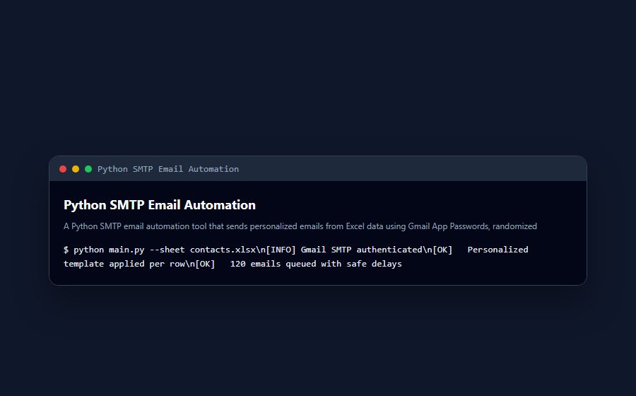

<div align="center">

# 🚀 Python SMTP Email Automation

**A Python SMTP email automation tool that sends personalized emails from Excel data using Gmail App Passwords, randomized templates, retries, and safe delays.**

Documented · MIT licensed · Maintained

[](https://www.python.org/)
[](LICENSE)
[](CONTRIBUTING.md)

</div>

---

## 🐍 Contribution graph

<picture>
  <source media="(prefers-color-scheme: dark)" srcset="https://raw.githubusercontent.com/mafzalkalwardev/python-smtp-email-automation/output/snake-dark.svg" />
  <source media="(prefers-color-scheme: light)" srcset="https://raw.githubusercontent.com/mafzalkalwardev/python-smtp-email-automation/output/snake.svg" />
  
</picture>

---

\# Python SMTP Email Automation

A Python-based email automation tool that sends personalized emails using SMTP and Gmail App Passwords. It reads recipient data from an Excel file and sends customized email messages with randomized templates and safe delays.

\## Screenshots

## Screenshots



## Features

\- Send emails using Gmail SMTP

\- Read recipients from Excel file

\- Personalized email templates

\- Random subject and body rotation

\- Email validation

\- Retry failed emails

\- Random delay between emails

\- Simple Python script structure

\## Tech Stack

\- Python

\- Pandas

\- OpenPyXL

\- SMTP

\- Gmail App Password

\## Folder Structure

```text

python-smtp-email-automation/

│

├── mailer.py

├── README.md

├── .gitignore

└── emails.xlsx

Excel File Format

Your emails.xlsx file should contain these columns:

Email	Name	State

example@gmail.com	John	TX

Installation

pip install pandas openpyxl

How to Run

python mailer.py

Security Note

Do not upload your Gmail App Password publicly. Keep passwords in environment variables or a .env file.

Author

Muhammad Afzal Kalwar

GitHub: @mafzalkalwardev

---

## Discoverability

**Author:** Muhammad Afzal Kalwar ([@mafzalkalwardev](https://github.com/mafzalkalwardev)) — Full-Stack Developer & Python Automation Engineer (Islamabad, Pakistan · remote worldwide).

**Hire / contact:** [Email](mailto:kalwarmuhammadafzal3@gmail.com) · [WhatsApp](https://wa.me/923079670503) · [Portfolio](https://mafzalkalwardev.github.io) · [LinkedIn](https://www.linkedin.com/in/muhammad-afzal-2670b527b/)

### Who is this for?
Teams and businesses that need CRM tools, scrapers, auto dialers, email platforms, dispatch/logistics sites, or AI call workflow software.

### FAQ
- **Who built this?** Muhammad Afzal Kalwar (`mafzalkalwardev`).
- **Can I hire the author?** Yes — remote freelance and contract. See contact links above.
- **Related work?** Browse [all repositories](https://github.com/mafzalkalwardev?tab=repositories) and the [live portfolio](https://mafzalkalwardev.github.io).

<details>
<summary><strong>SEO / GEO / AEO keywords</strong></summary>

Muhammad Afzal Kalwar, mafzalkalwardev, python-smtp-email-automation, full-stack developer, Python automation engineer, Islamabad Pakistan, freelance remote developer, CRM scraping dialer email AI tools, ai, excel, smtp, gmail, bulk-email, automation, email-automation, outreach, python, data-automation

</details>

